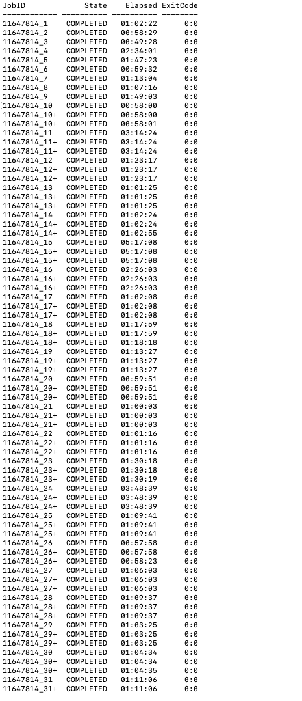
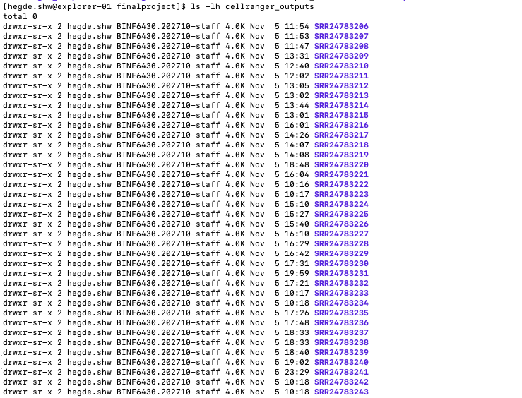
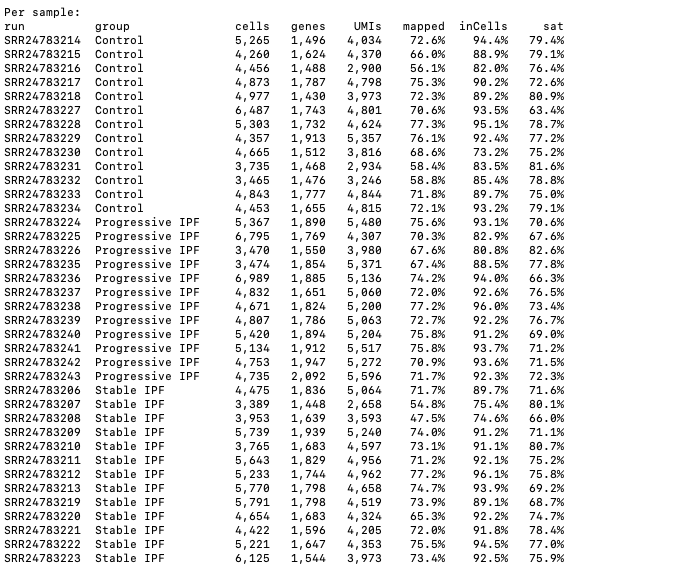
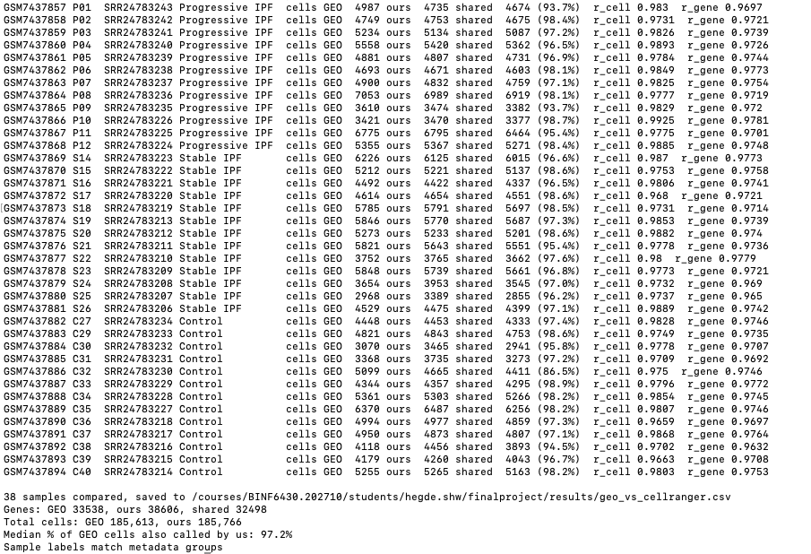

# ipf-scrnaseq-reproduction
Reproduction of Unterman et al. (2024, AJRCCM): single-cell RNA-seq of PBMCs from 38 subjects (13 controls, 13 stable IPF, 12 progressive IPF). Raw reads from SRA (PRJNA978083, GEO GSE233844) processed with Cell Ranger, then analyzed in Scanpy: QC, clustering, cell type annotation, composition, and differential expression.

# Part 1: Downloading the Raw Data and Running Cell Ranger

This README describes how we downloaded the raw single-cell RNA-seq data for the 38 PBMC samples in Unterman et al. (2024) and processed them with Cell Ranger. We first tested every step on six samples (two from each group). Once that worked, we collected the metadata for the whole study and wrote a single pipeline script that ran all of the steps for the remaining 32 samples.

Paper: Unterman A, et al. Single-Cell Profiling Reveals Immune Aberrations in Progressive Idiopathic Pulmonary Fibrosis. Am J Respir Crit Care Med. 2024;210(4):484.

Data: GEO GSE233844, BioProject PRJNA978083, SRA study SRP440530, runs SRR24783206 to SRR24783243.

The study has 38 samples: 13 healthy controls, 13 stable IPF, and 12 progressive IPF. Each sample has one sequencing run, and all runs are public. The libraries were made with the 10x Genomics 5' kit and sequenced on an Illumina HiSeq 4000.

We ran everything on Northeastern's Explorer cluster, which uses Slurm.


## Software and reference

- SRA Toolkit 3.2.0 (prefetch and fasterq-dump), from the cluster module sratoolkit/12Dec2024
- Cell Ranger 10.1.0, downloaded from the 10x Genomics website
- Human reference GRCh38-2024-A, downloaded from the 10x Genomics website
- Conda 24.5.0, from the cluster module anaconda3/2024.06
- Python 3.13.5, from the cluster module python/3.13.5


## Where we kept our files

We used two storage areas:

- Course folder: /courses/BINF6430.202710/students/hegde.shw/
  This is permanent storage. We kept the software, reference genome, metadata, scripts, and Cell Ranger results here.
- Scratch: /scratch/hegde.shw/ipf/
  This has a lot of space but can be cleared, so we only used it for the large temporary files (downloads and FASTQs) and job logs.

```
/courses/BINF6430.202710/students/hegde.shw/
    software/cellranger-10.1.0/
    finalproject/
        refdata-gex-GRCh38-2024-A/
        sample_metadata.csv
        cellranger_outputs/

/scratch/hegde.shw/ipf/
    sra/   fastq/   tmp/   cellranger/   logs/
```


## Step 1. Setting up on the cluster

We logged in to the cluster:

```bash
ssh hegde.shw@login.explorer.northeastern.edu
```

The login node is only for light tasks, so we started an interactive session on a compute node:

```bash
srun --partition=short --nodes=1 --cpus-per-task=2 --mem=8G --time=02:00:00 --pty /bin/bash
```

We found our course folder and scratch folder:

```bash
echo $HOME                        # /home/hegde.shw
ls -d /courses/*/students/$USER   # /courses/BINF6430.202710/students/hegde.shw
ls -d /scratch/$USER              # /scratch/hegde.shw
```


## Step 2. Conda and the SRA Toolkit

Typing conda at first gave "conda: command not found". On Explorer, conda is provided by a module called anaconda3 (searching for "conda" alone finds nothing):

```bash
module avail anaconda3
module load anaconda3/2024.06
conda --version                   # conda 24.5.0
```

We first tried to install the SRA Toolkit into a conda environment, but the command failed because we had copied an example path containing the placeholder YOUR_GROUP. While checking what else was available, we found that the cluster already has the SRA Toolkit as a module, so we used that instead:

```bash
module avail sra                  # sratoolkit/12Dec2024
module load sratoolkit/12Dec2024
prefetch --version                # prefetch : 3.2.0
fasterq-dump --version            # fasterq-dump : 3.2.0
```

Conda environments should be created in the course folder with --prefix rather than in the home folder, which has a small quota. The environment for the Scanpy analysis (Part 2) is set up this way:

```bash
module load anaconda3/2024.06
mkdir -p /scratch/$USER/conda_pkgs
export CONDA_PKGS_DIRS=/scratch/$USER/conda_pkgs

conda create --prefix=/courses/BINF6430.202710/students/hegde.shw/finalproject/envs/scanpy \
  -c conda-forge -c bioconda python=3.11 \
  scanpy anndata python-igraph louvain leidenalg scrublet ipykernel -y
source activate /courses/BINF6430.202710/students/hegde.shw/finalproject/envs/scanpy
pip install celltypist decoupler pydeseq2 scikit-misc

conda env export > /courses/BINF6430.202710/students/hegde.shw/finalproject/environment.yml
```

On Explorer, environments made with --prefix are activated with source activate followed by the full path.


## Step 3. Installing Cell Ranger

Cell Ranger was not available on the cluster:

```bash
module avail cellranger           # nothing found
```

We downloaded it from the 10x Genomics website, which gives a curl command with a personal download link after you fill out a short form. The link expires, so it isn't included here.

The 10x instructions say to cd /opt first. When we did that, the download failed with "Permission denied", because /opt is a system folder that students can't write to. We made a software folder in our course folder and downloaded it there:

```bash
mkdir -p /courses/BINF6430.202710/students/hegde.shw/software
cd /courses/BINF6430.202710/students/hegde.shw/software
curl -o cellranger-10.1.0.tar.gz "<download link from the 10x website>"
tar -xzf cellranger-10.1.0.tar.gz
rm cellranger-10.1.0.tar.gz
```

We added Cell Ranger to our PATH so the command works from any folder, and checked it:

```bash
echo 'export PATH=/courses/BINF6430.202710/students/hegde.shw/software/cellranger-10.1.0:$PATH' >> ~/.bashrc
source ~/.bashrc
cellranger --version
```


## Step 4. Downloading the reference genome

Cell Ranger needs a reference genome to align reads to. We made a finalproject folder and downloaded the human GRCh38-2024-A reference from the same 10x page:

```bash
mkdir -p /courses/BINF6430.202710/students/hegde.shw/finalproject
cd /courses/BINF6430.202710/students/hegde.shw/finalproject
curl -O "<GRCh38-2024-A link from the 10x website>"
tar -xzf refdata-gex-GRCh38-2024-A.tar.gz
```

We checked that it unpacked completely:

```bash
ls refdata-gex-GRCh38-2024-A        # fasta  genes  reference.json  star
du -sh refdata-gex-GRCh38-2024-A    # 16G
```


## Step 5. Test run on six samples

Before downloading all 38 samples, we tested every step on two samples from each group:

- Control: SRR24783233, SRR24783234
- Stable IPF: SRR24783222, SRR24783223
- Progressive IPF: SRR24783242, SRR24783243


### 5.1 Downloading the six samples

We made our scratch folders and a list of the six runs:

```bash
mkdir -p /scratch/$USER/ipf/{sra,fastq,tmp,logs}
cd /scratch/$USER/ipf
cat > runs.txt << 'EOF'
SRR24783234
SRR24783233
SRR24783223
SRR24783222
SRR24783243
SRR24783242
EOF
```

Then we wrote a Slurm job array script. Each of the six tasks reads one line of runs.txt, downloads that run with prefetch, and converts it to FASTQ with fasterq-dump:

```bash
cat > download.sh << 'EOF'
#!/bin/bash
#SBATCH --job-name=sra_dl
#SBATCH --partition=short
#SBATCH --cpus-per-task=8
#SBATCH --mem=32G
#SBATCH --time=08:00:00
#SBATCH --array=1-6
#SBATCH --output=/scratch/%u/ipf/logs/dl_%A_%a.out
module load sratoolkit/12Dec2024
SRR=$(sed -n "${SLURM_ARRAY_TASK_ID}p" /scratch/$USER/ipf/runs.txt)
prefetch $SRR -O /scratch/$USER/ipf/sra --max-size 100G
fasterq-dump /scratch/$USER/ipf/sra/$SRR --split-files --include-technical \
  -e 8 -t /scratch/$USER/ipf/tmp -O /scratch/$USER/ipf/fastq
EOF

sbatch download.sh
squeue -u $USER
```

Notes on the commands:

- prefetch downloads the run as a .sra file, which is NCBI's compressed format (about 9 GB per sample). The -O option saves it to scratch; otherwise prefetch saves to the home folder.
- fasterq-dump converts the .sra file to plain-text FASTQ (about 115 GB per sample).
- --include-technical is needed for 10x data. Without it, the cell barcode read is dropped.
- -t puts the large temporary files in scratch.

During the download, our interactive session ended with "CANCELLED ... DUE TO TIME LIMIT". This only ended our srun terminal session. The download jobs were submitted with sbatch, so they kept running.

All six tasks completed (exit code 0:0) in 30 minutes to 1.5 hours each:

```bash
sacct -j <JOBID> --format=JobID,State,Elapsed,ExitCode
```


### 5.2 Checking the conversion and deleting the .sra files

Before deleting the .sra files, we checked that fasterq-dump wrote every read it read for each sample:

```bash
grep -E "reads read|reads written" /scratch/$USER/ipf/logs/dl_*.out
```

The two numbers matched for all six samples (for example, 501,904,119 reads read and written for SRR24783242), so we deleted the .sra files:

```bash
rm -r /scratch/$USER/ipf/sra/SRR*
df -h /scratch/$USER
```


### 5.3 Identifying the three FASTQ files

fasterq-dump made three files for each sample (_1, _2 and _3), because 10x libraries have three reads. The numbers don't say which read is which, so we checked the length of the first read in each file. wc -c counts the newline character too, so we subtract 1:

```bash
cd /scratch/$USER/ipf/fastq
ls -lh
for f in SRR24783234_*.fastq; do echo "$f: $(( $(head -2 $f | tail -1 | wc -c) - 1 )) bp"; done
```

```
SRR24783234_1.fastq: 8 bp
SRR24783234_2.fastq: 26 bp
SRR24783234_3.fastq: 98 bp
```

This means:

- _1 (8 bp) is I1, the sample index
- _2 (26 bp) is R1, the 16 bp cell barcode plus the 10 bp UMI
- _3 (98 bp) is R2, the cDNA that is aligned to the genome

The file sizes followed the same pattern for every sample (about 27, 34 and 58 GB).


### 5.4 Renaming the files for Cell Ranger

Cell Ranger expects one folder per sample, with files named like SAMPLE_S1_L001_R1_001.fastq. We renamed all six samples:

```bash
cd /scratch/$USER/ipf/fastq
for s in SRR24783234 SRR24783233 SRR24783223 SRR24783222 SRR24783243 SRR24783242; do
  mkdir -p $s
  mv ${s}_1.fastq $s/${s}_S1_L001_I1_001.fastq
  mv ${s}_2.fastq $s/${s}_S1_L001_R1_001.fastq
  mv ${s}_3.fastq $s/${s}_S1_L001_R2_001.fastq
done
ls -R | head -20
```

Cell Ranger can read uncompressed FASTQ files, so we didn't compress them.


### 5.5 Running Cell Ranger on the six samples

First we checked the time limit on the short partition, which is 2 days:

```bash
sinfo -p short -o "%P %l"
```

Then we wrote a job array script for Cell Ranger:

```bash
mkdir -p /scratch/$USER/ipf/cellranger
cd /scratch/$USER/ipf
ls fastq > samples.txt
cat > cellranger.sh << 'EOF'
#!/bin/bash
#SBATCH --job-name=cr_count
#SBATCH --partition=short
#SBATCH --cpus-per-task=16
#SBATCH --mem=64G
#SBATCH --time=12:00:00
#SBATCH --array=1-6
#SBATCH --output=/scratch/%u/ipf/logs/cr_%A_%a.out
export PATH=/courses/BINF6430.202710/students/hegde.shw/software/cellranger-10.1.0:$PATH
S=$(sed -n "${SLURM_ARRAY_TASK_ID}p" /scratch/$USER/ipf/samples.txt)
cd /scratch/$USER/ipf/cellranger
cellranger count --id=$S --sample=$S \
  --fastqs=/scratch/$USER/ipf/fastq/$S \
  --transcriptome=/courses/BINF6430.202710/students/hegde.shw/finalproject/refdata-gex-GRCh38-2024-A \
  --create-bam=false --localcores=16 --localmem=60
EOF
cat samples.txt
```

To be safe, we raised the time limit to 24 hours before submitting:

```bash
sed -i 's/--time=12:00:00/--time=24:00:00/' cellranger.sh
sbatch cellranger.sh
squeue -u $USER
```

Notes on the commands:

- --create-bam=false is required in Cell Ranger 8 and later. We don't need the BAM files, and skipping them saves a lot of space.
- Cell Ranger detected the 5' chemistry automatically.

All six tasks completed in 58 to 88 minutes each:

```bash
sacct -j <JOBID> --format=JobID,State,Elapsed,MaxRSS,ExitCode
ls /scratch/$USER/ipf/cellranger/*/outs/web_summary.html
ls /scratch/$USER/ipf/cellranger/*/outs/filtered_feature_bc_matrix/
```

Slurm reported peak memory between 55 and 140 GB, which is more than the 64 GB we asked for. The jobs still finished, but we requested 128 GB for the later run to be safe.


### 5.6 Checking the QC results

We pulled the main QC numbers from each sample's metrics_summary.csv into one table:

```bash
module load python/3.13.5
cd /scratch/$USER/ipf/cellranger
python3 -c "
import csv, glob
cols = ['Estimated Number of Cells','Median Genes per Cell','Median UMI Counts per Cell','Reads Mapped Confidently to Transcriptome','Fraction Reads in Cells','Sequencing Saturation']
print('Sample\t' + '\t'.join(c.replace(' ','_') for c in cols))
for f in sorted(glob.glob('*/outs/metrics_summary.csv')):
    r = next(csv.DictReader(open(f)))
    print(f.split('/')[0] + '\t' + '\t'.join(r.get(c,'NA') for c in cols))
"
```

```
Sample       Cells  Genes/cell  UMIs/cell  Mapped  InCells  Saturation
SRR24783222  5,221  1,647       4,353      75.5%   94.5%    77.0%
SRR24783223  6,125  1,544       3,973      73.4%   92.5%    75.9%
SRR24783233  4,843  1,777       4,844      71.8%   89.7%    75.0%
SRR24783234  4,453  1,655       4,815      72.1%   93.2%    79.1%
SRR24783242  4,753  1,947       5,272      70.9%   93.6%    71.5%
SRR24783243  4,735  2,092       5,596      71.7%   92.3%    72.3%
```

All six samples looked good compared with typical values for 10x PBMC data (several thousand cells, over 1,000 median genes per cell, over 50-60% of reads mapped to the transcriptome, over 70% of reads in cells, and over 50% sequencing saturation). The paper kept 149,564 cells from 38 samples after QC, about 3,900 per sample. Our cell counts are before QC filtering, so being somewhat higher is expected.


### 5.7 Checking that each run is a different sample

If two runs were the same library sequenced twice, they would share most of their cell barcodes. Different samples only share a few dozen barcodes by chance (about 5,000 cells out of roughly 737,000 possible barcodes). We compared the two samples in each group:

```bash
cd /scratch/$USER/ipf/cellranger
for p in "SRR24783233 SRR24783234" "SRR24783222 SRR24783223" "SRR24783242 SRR24783243"; do
  set -- $p
  n=$(comm -12 <(zcat $1/outs/filtered_feature_bc_matrix/barcodes.tsv.gz | sort) \
               <(zcat $2/outs/filtered_feature_bc_matrix/barcodes.tsv.gz | sort) | wc -l)
  echo "$1 vs $2: $n shared barcodes"
done
```

```
SRR24783233 vs SRR24783234: 33 shared barcodes
SRR24783222 vs SRR24783223: 42 shared barcodes
SRR24783242 vs SRR24783243: 31 shared barcodes
```

All pairs are separate samples.


### 5.8 Saving the outputs and cleaning up

We copied each sample's outs folder to the course folder and checked the sizes:

```bash
mkdir -p /courses/BINF6430.202710/students/hegde.shw/finalproject/cellranger_outputs
for s in $(cat /scratch/$USER/ipf/samples.txt); do
  cp -r /scratch/$USER/ipf/cellranger/$s/outs /courses/BINF6430.202710/students/hegde.shw/finalproject/cellranger_outputs/$s
done
du -sh /courses/BINF6430.202710/students/hegde.shw/finalproject/cellranger_outputs/*
ls /courses/BINF6430.202710/students/hegde.shw/finalproject/cellranger_outputs/SRR24783222
```

Each sample was 355 to 441 MB and contained:

- filtered_feature_bc_matrix/ and filtered_feature_bc_matrix.h5: the cell-by-gene counts for real cells, which we load into Scanpy
- raw_feature_bc_matrix/ and raw_feature_bc_matrix.h5: the counts for all barcodes, including empty droplets
- metrics_summary.csv and web_summary.html: the QC numbers and Cell Ranger's QC report
- molecule_info.h5: information on each molecule
- cloupe.cloupe: a file for 10x's Loupe Browser
- analysis/: Cell Ranger's own clustering
- cell_types/: Cell Ranger's automatic cell type predictions (we didn't use these, because they aren't part of the paper's method)

After confirming the copies, we deleted the FASTQs and the Cell Ranger working folders from scratch (about 700 GB):

```bash
rm -r /scratch/$USER/ipf/fastq/SRR*
rm -r /scratch/$USER/ipf/cellranger/SRR*
```


## Step 6. Making the metadata for all 38 samples

After the test run worked, we got the information for every sample in the study from the SRA Run Selector:

1. On the GEO page for GSE233844, we clicked the SRA link under Relations.
2. On the SRA page, we chose Send to, then Run Selector, then Go.
3. We downloaded the Metadata file (SraRunTable.csv) and the Accession List (SRR_Acc_List.txt).
4. We uploaded both files to /scratch/hegde.shw/ipf/ using the Files page on Open OnDemand (ood.explorer.northeastern.edu).

SraRunTable.csv confirmed that:

- there are 38 runs (SRR24783206 to SRR24783243), one per sample
- the disease group is in the group_assignment column: 13 Control, 13 Stable IPF, and 12 Progressive IPF
- the GEO sample ID (GSM7437857 to GSM7437894) is in the Sample Name column
- all runs have public consent
- there is no column for processing batch

From SraRunTable.csv we made a simpler sample sheet, sample_metadata.csv, that keeps only the columns we need: the run, the GEO sample ID, the group, sex, smoking status, pack-years and race/ethnicity. The rows are sorted by group. We uploaded it to the finalproject folder and checked it:

```bash
ls -lh /courses/BINF6430.202710/students/hegde.shw/finalproject/sample_metadata.csv
head -3 /courses/BINF6430.202710/students/hegde.shw/finalproject/sample_metadata.csv
```

```
Run,Sample Name,group_assignment,sex,smoking,pack_years,race/ethnicity
SRR24783214,GSM7437894,Control,male,Ever,not applicable,Caucasian
SRR24783215,GSM7437893,Control,male,Never,not applicable,Caucasian
```

The full sample sheet:

| Run | GEO sample | Group | Sex | Smoking | Pack-years | Race/ethnicity |
|---|---|---|---|---|---|---|
| SRR24783214 | GSM7437894 | Control | male | Ever | not applicable | Caucasian |
| SRR24783215 | GSM7437893 | Control | male | Never | not applicable | Caucasian |
| SRR24783216 | GSM7437892 | Control | male | Never | not applicable | Caucasian |
| SRR24783217 | GSM7437891 | Control | female | Never | not applicable | Caucasian |
| SRR24783218 | GSM7437890 | Control | male | Ever | not applicable | Caucasian |
| SRR24783227 | GSM7437889 | Control | male | Ever | not applicable | Caucasian |
| SRR24783228 | GSM7437888 | Control | female | Ever | not applicable | Caucasian |
| SRR24783229 | GSM7437887 | Control | male | Ever | not applicable | Caucasian |
| SRR24783230 | GSM7437886 | Control | male | Ever | not applicable | Caucasian |
| SRR24783231 | GSM7437885 | Control | female | Never | not applicable | Caucasian |
| SRR24783232 | GSM7437884 | Control | male | Ever | not applicable | Caucasian |
| SRR24783233 | GSM7437883 | Control | male | Ever | not applicable | Caucasian |
| SRR24783234 | GSM7437882 | Control | male | Ever | not applicable | Caucasian |
| SRR24783206 | GSM7437881 | Stable IPF | male | Never | 0 | Caucasian |
| SRR24783207 | GSM7437880 | Stable IPF | male | Ever | 15 | Caucasian |
| SRR24783208 | GSM7437879 | Stable IPF | male | Ever | 90 | Caucasian |
| SRR24783209 | GSM7437878 | Stable IPF | male | Ever | 50 | Caucasian |
| SRR24783210 | GSM7437877 | Stable IPF | female | Never | 0 | Caucasian |
| SRR24783211 | GSM7437876 | Stable IPF | male | Ever | not applicable | Caucasian |
| SRR24783212 | GSM7437875 | Stable IPF | female | Ever | 40 | Caucasian |
| SRR24783213 | GSM7437874 | Stable IPF | male | Ever | not applicable | Caucasian |
| SRR24783219 | GSM7437873 | Stable IPF | male | Ever | 14 | Caucasian |
| SRR24783220 | GSM7437872 | Stable IPF | male | Ever | 90 | Caucasian |
| SRR24783221 | GSM7437871 | Stable IPF | male | Ever | 50 | Caucasian |
| SRR24783222 | GSM7437870 | Stable IPF | male | Never | 0 | Caucasian |
| SRR24783223 | GSM7437869 | Stable IPF | female | Ever | 30 | Caucasian |
| SRR24783224 | GSM7437868 | Progressive IPF | male | Never | 0 | Asian Indian |
| SRR24783225 | GSM7437867 | Progressive IPF | male | Ever | 30 | Caucasian |
| SRR24783226 | GSM7437866 | Progressive IPF | male | Ever | 37.5 | Caucasian |
| SRR24783235 | GSM7437865 | Progressive IPF | male | Never | 0 | Caucasian |
| SRR24783236 | GSM7437864 | Progressive IPF | male | Ever | 60 | Caucasian |
| SRR24783237 | GSM7437863 | Progressive IPF | female | Ever | 40 | Caucasian |
| SRR24783238 | GSM7437862 | Progressive IPF | male | Ever | 112 | Caucasian |
| SRR24783239 | GSM7437861 | Progressive IPF | female | Ever | 120 | Caucasian |
| SRR24783240 | GSM7437860 | Progressive IPF | male | Never | 0 | Caucasian |
| SRR24783241 | GSM7437859 | Progressive IPF | male | Ever | 5 | Caucasian |
| SRR24783242 | GSM7437858 | Progressive IPF | male | Ever | 60 | Caucasian |
| SRR24783243 | GSM7437857 | Progressive IPF | male | Never | 0 | Caucasian |

We will use this file in Part 2 to label each cell with its group.


## Step 7. Pipeline for the remaining 32 samples

For the rest of the samples, we combined all of the steps from the test run into one script so that each sample goes from download to Cell Ranger results in a single job, and the large files are deleted as soon as they aren't needed.

First we made a list of the 32 runs that still needed processing:

```bash
cd /scratch/$USER/ipf
cat > new_runs.txt << 'EOF'
SRR24783206
SRR24783207
SRR24783208
SRR24783209
SRR24783210
SRR24783211
SRR24783212
SRR24783213
SRR24783214
SRR24783215
SRR24783216
SRR24783217
SRR24783218
SRR24783219
SRR24783220
SRR24783221
SRR24783224
SRR24783225
SRR24783226
SRR24783227
SRR24783228
SRR24783229
SRR24783230
SRR24783231
SRR24783232
SRR24783235
SRR24783236
SRR24783237
SRR24783238
SRR24783239
SRR24783240
SRR24783241
EOF
wc -l new_runs.txt                 # 32
```

Then we wrote the pipeline script. For each sample it:

1. downloads the .sra file with prefetch
2. converts it to FASTQ with fasterq-dump and deletes the .sra file
3. checks the length of each read and renames the files to I1, R1 and R2 (the same check we did by hand in step 5.3), and stops if R1 or R2 is missing
4. runs cellranger count
5. copies the outs folder to cellranger_outputs
6. deletes the FASTQs and the Cell Ranger working folder from scratch

If a sample already has a folder in cellranger_outputs, it is skipped, so the job can be resubmitted if something fails. set -euo pipefail makes the script stop at the first error, so the end of the log shows which step failed.

```bash
cd /scratch/$USER/ipf
cat > pipeline.sh << 'EOF'
#!/bin/bash
#SBATCH --job-name=ipf_pipe
#SBATCH --partition=short
#SBATCH --cpus-per-task=16
#SBATCH --mem=128G
#SBATCH --time=24:00:00
#SBATCH --output=/scratch/%u/ipf/logs/pipe_%A_%a.out
set -euo pipefail
module load sratoolkit/12Dec2024
export PATH=/courses/BINF6430.202710/students/hegde.shw/software/cellranger-10.1.0:$PATH
BASE=/scratch/$USER/ipf
OUT=/courses/BINF6430.202710/students/hegde.shw/finalproject/cellranger_outputs
REF=/courses/BINF6430.202710/students/hegde.shw/finalproject/refdata-gex-GRCh38-2024-A
S=$(sed -n "${SLURM_ARRAY_TASK_ID}p" $BASE/new_runs.txt)
if [ -d $OUT/$S ]; then echo "$S already done"; exit 0; fi

# Download and convert
mkdir -p $BASE/sra $BASE/fastq/$S $BASE/tmp/$S
prefetch $S -O $BASE/sra --max-size 100G
fasterq-dump $BASE/sra/$S --split-files --include-technical -e 16 -t $BASE/tmp/$S -O $BASE/fastq/$S
rm -rf $BASE/sra/$S $BASE/tmp/$S

# Rename files by read length
cd $BASE/fastq/$S
for f in ${S}_*.fastq; do
  len=$(( $(head -2 $f | tail -1 | wc -c) - 1 ))
  if [ $len -le 10 ]; then r=I1; elif [ $len -le 30 ]; then r=R1; else r=R2; fi
  echo "$f: $len bp -> $r"
  mv $f ${S}_S1_L001_${r}_001.fastq
done
[ -f ${S}_S1_L001_R1_001.fastq ] && [ -f ${S}_S1_L001_R2_001.fastq ] || { echo "Missing R1/R2 for $S"; exit 1; }

# Cell Ranger
mkdir -p $BASE/cellranger
cd $BASE/cellranger
rm -rf $S
cellranger count --id=$S --sample=$S --fastqs=$BASE/fastq/$S --transcriptome=$REF \
  --create-bam=false --localcores=16 --localmem=120

# Save outputs, then clean up
cp -r $BASE/cellranger/$S/outs $OUT/$S
rm -rf $BASE/fastq/$S $BASE/cellranger/$S
echo "$S finished"
EOF
```

We checked the script for typos without running it:

```bash
ls -lh pipeline.sh
bash -n pipeline.sh && echo "Syntax OK"
```

We submitted it as a job array of 32 tasks, with at most 6 running at a time (%6) so that scratch never holds more than about six samples' worth of FASTQs:

```bash
sbatch --array=1-32%6 pipeline.sh
squeue -u $USER
```

Our job ID was 11647814. Each task asks for 16 CPUs, 128 GB of memory and up to 24 hours.


## Step 8. Checking on the jobs

To see which tasks are running (R) or waiting (PD):

```bash
squeue -u $USER
```

When a task is waiting with the reason "Priority", it means other users' jobs are ahead in the queue.

To see which step each running sample is on:

```bash
for f in /scratch/$USER/ipf/logs/pipe_11647814_*.out; do echo "== $f"; tail -2 "$f"; done
```

The end of each log shows the current step:

- "Downloading via HTTPS..." means it is downloading the .sra file
- "was downloaded successfully" or "spots read" means it is converting to FASTQ
- "8 bp -> I1", "26 bp -> R1", "98 bp -> R2" means the files were renamed and Cell Ranger is starting
- Cell Ranger stage names mean Cell Ranger is running
- "SRR... finished" means the sample is done and the results were copied

While a sample is downloading, the size of its .sra.tmp file shows the progress. The full size of each run is in the Bytes column of SraRunTable.csv (about 9 GB):

```bash
ls -lh /scratch/$USER/ipf/sra/SRR24783206/
```

The log times are in UTC, while ls shows Eastern time, so they look 5 hours apart.

To see which tasks finished and their exit codes (0:0 means success):

```bash
sacct -j 11647814 --format=JobID,State,Elapsed,ExitCode | grep -v "\.+"
```

If a task fails, the last lines of its log show which step went wrong:

```bash
tail -30 /scratch/$USER/ipf/logs/pipe_11647814_<TASK>.out
```

To count how many samples are finished (38 when everything is done):

```bash
ls /courses/BINF6430.202710/students/hegde.shw/finalproject/cellranger_outputs | wc -l
```


## Results for all 38 samples

### QC summary script

To collect the QC numbers for every finished sample in one place, we wrote qc_summary.py. It reads sample_metadata.csv, opens the metrics_summary.csv file in each sample's Cell Ranger output folder, adds the sample's group, and saves everything to results/cellranger_qc_summary.csv. It also prints a table of each sample, the median of each metric for each group, and a list of the samples that haven't finished yet, so we could run it while the pipeline was still going.

```bash
mkdir -p /courses/BINF6430.202710/students/hegde.shw/finalproject/scripts
cd /courses/BINF6430.202710/students/hegde.shw/finalproject
cat > scripts/qc_summary.py << 'EOF'
#!/usr/bin/env python3
"""Combine Cell Ranger QC metrics for all samples with their group labels."""
import csv, os, statistics

PROJ = "/courses/BINF6430.202710/students/hegde.shw/finalproject"
META = f"{PROJ}/sample_metadata.csv"
OUT_DIR = f"{PROJ}/cellranger_outputs"
os.makedirs(f"{PROJ}/results", exist_ok=True)
OUT_FILE = f"{PROJ}/results/cellranger_qc_summary.csv"

metrics = ["Estimated Number of Cells", "Mean Reads per Cell", "Median Genes per Cell",
           "Median UMI Counts per Cell", "Reads Mapped Confidently to Transcriptome",
           "Fraction Reads in Cells", "Sequencing Saturation"]

def num(x):
    try:
        return float(x.replace(",", "").replace("%", ""))
    except (ValueError, AttributeError):
        return None

rows, missing = [], []
for m in csv.DictReader(open(META)):
    f = f"{OUT_DIR}/{m['Run']}/metrics_summary.csv"
    if not os.path.exists(f):
        missing.append(m["Run"])
        continue
    r = next(csv.DictReader(open(f)))
    row = {"run": m["Run"], "gsm": m["Sample Name"], "group": m["group_assignment"], "sex": m["sex"]}
    row.update({k: r.get(k, "NA") for k in metrics})
    rows.append(row)

with open(OUT_FILE, "w", newline="") as f:
    w = csv.DictWriter(f, fieldnames=["run", "gsm", "group", "sex"] + metrics, lineterminator="\n")
    w.writeheader()
    w.writerows(rows)

print(f"{len(rows)} samples finished, saved to {OUT_FILE}")
if missing:
    print(f"{len(missing)} not finished yet: {' '.join(missing)}")

print("\nPer sample:")
print("run".ljust(13) + "group".ljust(17) + "cells".rjust(8) + "genes".rjust(8) + "UMIs".rjust(8) + "mapped".rjust(9) + "inCells".rjust(9) + "sat".rjust(8))
for r in rows:
    print(r["run"].ljust(13) + r["group"].ljust(17) + r[metrics[0]].rjust(8) + r[metrics[2]].rjust(8)
          + r[metrics[3]].rjust(8) + r[metrics[4]].rjust(9) + r[metrics[5]].rjust(9) + r[metrics[6]].rjust(8))

print("\nMedian per group:")
for g in ["Control", "Stable IPF", "Progressive IPF"]:
    sub = [r for r in rows if r["group"] == g]
    if not sub:
        continue
    vals = []
    for k in [metrics[0], metrics[2], metrics[3], metrics[4], metrics[5], metrics[6]]:
        v = [x for x in (num(r[k]) for r in sub) if x is not None]
        vals.append(f"{statistics.median(v):,.1f}" if v else "NA")
    print(f"{g} (n={len(sub)}): cells {vals[0]}, genes {vals[1]}, UMIs {vals[2]}, "
          f"mapped {vals[3]}%, in cells {vals[4]}%, saturation {vals[5]}%")
EOF
```

To run it, we first checked that the pipeline jobs had finished and counted the finished samples, then ran the script:

```bash
sacct -j 11647814 --format=JobID,State,Elapsed,ExitCode | grep -v "\.+"
ls /courses/BINF6430.202710/students/hegde.shw/finalproject/cellranger_outputs | wc -l
cd /courses/BINF6430.202710/students/hegde.shw/finalproject
module load python/3.13.5
python3 scripts/qc_summary.py
```

### Job results

All 32 tasks in job 11647814 completed with exit code 0:0, so together with the six test samples, all 38 samples were processed successfully. Most samples took about 1 hour from download to finished Cell Ranger output. A few took longer (up to 5 hours 17 minutes for SRR24783220), most likely because of larger downloads or busier nodes, but this was still far below the 24-hour limit, and their QC results were normal.



```
JobID             State    Elapsed ExitCode
------------ ---------- ---------- --------
11647814_1    COMPLETED   01:02:22      0:0
11647814_2    COMPLETED   00:58:29      0:0
...
11647814_15   COMPLETED   05:17:08      0:0
...
11647814_32   COMPLETED   04:57:29      0:0
38
```


All 38 output folders were in cellranger_outputs, taking up 15 GB in total:

```bash
ls -lh cellranger_outputs
du -sh cellranger_outputs          # 15G
```



After the pipeline finished, the sra, fastq, tmp and cellranger folders in scratch were empty. We copied our cluster scripts, run lists and job logs from scratch to finalproject/scripts/cluster_scripts and finalproject/logs, and deleted the GEO .tar file since it was already unpacked.

### QC results for all 38 samples

Output from qc_summary.py after all samples finished:



```
38 samples finished, saved to /courses/BINF6430.202710/students/hegde.shw/finalproject/results/cellranger_qc_summary.csv

Per sample:
run          group               cells   genes    UMIs   mapped  inCells     sat
SRR24783214  Control             5,265   1,496   4,034    72.6%    94.4%   79.4%
SRR24783215  Control             4,260   1,624   4,370    66.0%    88.9%   79.1%
SRR24783216  Control             4,456   1,488   2,900    56.1%    82.0%   76.4%
SRR24783217  Control             4,873   1,787   4,798    75.3%    90.2%   72.6%
SRR24783218  Control             4,977   1,430   3,973    72.3%    89.2%   80.9%
SRR24783227  Control             6,487   1,743   4,801    70.6%    93.5%   63.4%
SRR24783228  Control             5,303   1,732   4,624    77.3%    95.1%   78.7%
SRR24783229  Control             4,357   1,913   5,357    76.1%    92.4%   77.2%
SRR24783230  Control             4,665   1,512   3,816    68.6%    73.2%   75.2%
SRR24783231  Control             3,735   1,468   2,934    58.4%    83.5%   81.6%
SRR24783232  Control             3,465   1,476   3,246    58.8%    85.4%   78.8%
SRR24783233  Control             4,843   1,777   4,844    71.8%    89.7%   75.0%
SRR24783234  Control             4,453   1,655   4,815    72.1%    93.2%   79.1%
SRR24783224  Progressive IPF     5,367   1,890   5,480    75.6%    93.1%   70.6%
SRR24783225  Progressive IPF     6,795   1,769   4,307    70.3%    82.9%   67.6%
SRR24783226  Progressive IPF     3,470   1,550   3,980    67.6%    80.8%   82.6%
SRR24783235  Progressive IPF     3,474   1,854   5,371    67.4%    88.5%   77.8%
SRR24783236  Progressive IPF     6,989   1,885   5,136    74.2%    94.0%   66.3%
SRR24783237  Progressive IPF     4,832   1,651   5,060    72.0%    92.6%   76.5%
SRR24783238  Progressive IPF     4,671   1,824   5,200    77.2%    96.0%   73.4%
SRR24783239  Progressive IPF     4,807   1,786   5,063    72.7%    92.2%   76.7%
SRR24783240  Progressive IPF     5,420   1,894   5,204    75.8%    91.2%   69.0%
SRR24783241  Progressive IPF     5,134   1,912   5,517    75.8%    93.7%   71.2%
SRR24783242  Progressive IPF     4,753   1,947   5,272    70.9%    93.6%   71.5%
SRR24783243  Progressive IPF     4,735   2,092   5,596    71.7%    92.3%   72.3%
SRR24783206  Stable IPF          4,475   1,836   5,064    71.7%    89.7%   71.6%
SRR24783207  Stable IPF          3,389   1,448   2,658    54.8%    75.4%   80.1%
SRR24783208  Stable IPF          3,953   1,639   3,593    47.5%    74.6%   66.0%
SRR24783209  Stable IPF          5,739   1,939   5,240    74.0%    91.2%   71.1%
SRR24783210  Stable IPF          3,765   1,683   4,597    73.1%    91.1%   80.7%
SRR24783211  Stable IPF          5,643   1,829   4,956    71.2%    92.1%   75.2%
SRR24783212  Stable IPF          5,233   1,744   4,962    77.2%    96.1%   75.8%
SRR24783213  Stable IPF          5,770   1,798   4,658    74.7%    93.9%   69.2%
SRR24783219  Stable IPF          5,791   1,798   4,519    73.9%    89.1%   68.7%
SRR24783220  Stable IPF          4,654   1,683   4,324    65.3%    92.2%   74.7%
SRR24783221  Stable IPF          4,422   1,596   4,205    72.0%    91.8%   78.4%
SRR24783222  Stable IPF          5,221   1,647   4,353    75.5%    94.5%   77.0%
SRR24783223  Stable IPF          6,125   1,544   3,973    73.4%    92.5%   75.9%

Median per group:
Control (n=13): cells 4,665.0, genes 1,624.0, UMIs 4,370.0, mapped 71.8%, in cells 89.7%, saturation 78.7%
Stable IPF (n=13): cells 5,221.0, genes 1,683.0, UMIs 4,519.0, mapped 73.1%, in cells 91.8%, saturation 75.2%
Progressive IPF (n=12): cells 4,819.5, genes 1,869.5, UMIs 5,202.0, mapped 72.3%, in cells 92.4%, saturation 71.9%
```

Across all 38 samples:

- Cell Ranger called 185,766 cells in total, between 3,389 and 6,989 per sample.
- Median genes per cell ranged from 1,430 to 2,092, and median UMIs per cell from 2,658 to 5,596.
- Reads mapped confidently to the transcriptome ranged from 47.5% to 77.3%.
- Fraction of reads in cells ranged from 73.2% to 96.1%.
- Sequencing saturation ranged from 63.4% to 82.6%.

Every sample passed the usual thresholds for good 10x data of over 70% of reads in cells and over 1,000 median genes per cell, and all had sequencing saturation above 50%.

The three groups were very similar. The group medians for reads mapped to the transcriptome (71.8 to 73.1%) and reads in cells (89.7 to 92.4%) were almost the same, so differences we find later between groups are unlikely to be caused by one group having better-quality data. Progressive IPF samples had slightly more genes and UMIs per cell (medians of 1,870 genes and 5,202 UMIs, compared with about 1,620 to 1,680 genes and 4,370 to 4,520 UMIs in the other groups). This is a small difference that we will keep in mind in Part 2.

The paper kept 149,564 cells from these 38 samples after QC. Our 185,766 cells are before any QC filtering, so the paper's filters (at least 1,000 UMIs and under 12% mitochondrial reads) should remove roughly 20% of our cells if the two analyses agree. We will check this in Part 2.

Six samples had lower quality than the rest, with a lower fraction of reads mapped to the transcriptome and, for most, fewer UMIs per cell:

- SRR24783208 (Stable IPF): 47.5% mapped, 74.6% of reads in cells, 3,593 median UMIs
- SRR24783207 (Stable IPF): 54.8% mapped, 75.4% of reads in cells, 2,658 median UMIs
- SRR24783216 (Control): 56.1% mapped, 82.0% of reads in cells, 2,900 median UMIs
- SRR24783231 (Control): 58.4% mapped, 83.5% of reads in cells, 2,934 median UMIs
- SRR24783232 (Control): 58.8% mapped, 85.4% of reads in cells, 3,246 median UMIs
- SRR24783230 (Control): 68.6% mapped, 73.2% of reads in cells, 3,816 median UMIs

These samples come from both the control and stable IPF groups, so the lower quality is not tied to one disease group. A lower fraction of reads in cells can mean more ambient RNA or more damaged cells. All six still pass the basic thresholds, and the paper used all 38 samples, so we kept them. In Part 2 we will check their mitochondrial percentage, how many of their cells pass the paper's filters, and whether they cluster separately from the other samples on the UMAP.


## Comparing our Cell Ranger results with the authors' GEO files

The authors deposited their own Cell Ranger output for every sample on GEO. Comparing it with ours shows how much our newer Cell Ranger version and reference changed the results, before we start the Scanpy analysis. We didn't need the FASTQ files for this, because the comparison uses the count matrices.


### Downloading the GEO files

The GEO files are in GSE233844_RAW.tar (about 1.1 GB), listed under "Supplementary file" at the bottom of the GSE233844 page. We first downloaded it to a laptop and tried uploading it to the cluster with scp, but the connection kept dropping partway through. Downloading it directly on the cluster was faster and more reliable:

```bash
mkdir -p /scratch/$USER/ipf/geo
cd /scratch/$USER/ipf/geo
wget -c https://ftp.ncbi.nlm.nih.gov/geo/series/GSE233nnn/GSE233844/suppl/GSE233844_RAW.tar
tar -xf GSE233844_RAW.tar
ls -lh | head -20
ls | wc -l                         # 115
```

The -c option lets wget resume if the download is interrupted. (If uploading from a laptop is necessary, rsync -avP --partial can also resume, unlike scp.) We kept the GEO files in scratch, since they can be downloaded again in a few minutes if scratch is cleared.


### What was in the download

The 115 files are the .tar file plus three files for each of the 38 samples, named by GEO sample ID and the authors' own sample label:

```
GSM7437857_P01_barcodes.tsv.gz     25K    cell barcodes
GSM7437857_P01_features.tsv.gz    298K    genes
GSM7437857_P01_matrix.mtx.gz       31M    counts
```

These are the same three files as in our filtered_feature_bc_matrix folders, so the two can be compared directly.

We looked at the labels and at one sample's files:

```bash
cd /scratch/$USER/ipf/geo
ls *_barcodes.tsv.gz | sed 's/GSM[0-9]*_//; s/_barcodes.tsv.gz//' | tr '\n' ' '; echo
zcat GSM7437857_P01_features.tsv.gz | head -3
zcat GSM7437857_P01_features.tsv.gz | wc -l
zcat GSM7437857_P01_matrix.mtx.gz | head -3
zcat GSM7437857_P01_barcodes.tsv.gz | wc -l
```

```
P01 P02 P03 P04 P05 P06 P07 P08 P09 P10 P11 P12 S14 S15 S16 S17 S18 S19 S20 S21 S22 S23 S24 S25 S26 C27 C29 C30 C31 C32 C33 C34 C35 C36 C37 C38 C39 C40
ENSG00000243485	MIR1302-2HG	Gene Expression
ENSG00000237613	FAM138A	Gene Expression
ENSG00000186092	OR4F5	Gene Expression
33538
%%MatrixMarket matrix coordinate integer general
%metadata_json: {"format_version": 2, "software_version": "3.0.2"}
33538 4987 8435379
4987
```

What this tells us:

- The labels match the study design: P01 to P12 are the 12 progressive IPF samples, S14 to S26 are the 13 stable IPF samples, and C27 and C29 to C40 are the 13 controls.
- P13 and C28 are missing. The paper sequenced 40 samples and removed two during QC (one progressive and one control), which explains these gaps.
- The matrix header shows the files were made with Cell Ranger 3.0.2, the same version reported in the paper.
- There are 33,538 genes, which is the gene count of 10x's older GRCh38 3.0.0 reference. Our GRCh38-2024-A reference has more genes.
- The authors' run called 4,987 cells in P01 (GSM7437857). Our run of the same sample (SRR24783243) called 4,735 cells, about 5% fewer.

The GEO sample ID in each file name matches the Sample Name column in sample_metadata.csv, which is how we link each GEO sample to our SRR run.


### Comparison script

compare_geo.py compares the two versions of every sample that both we and GEO have. For each sample it reports:

- the number of cells each version called, and how many cell barcodes are the same in both
- the number of genes in each matrix, and how many are shared (matched by Ensembl gene ID)
- the median UMIs per cell in each version
- for cells found in both versions, the correlation of total UMIs per cell (on a log scale)
- for genes found in both versions, the correlation of total counts per gene (on a log scale)
- whether the authors' label (C, S or P) agrees with the group in our metadata

It only uses standard Python, so it runs with the python/3.13.5 module. Samples whose Cell Ranger run hasn't finished are skipped.

```bash
cd /courses/BINF6430.202710/students/hegde.shw/finalproject
cat > scripts/compare_geo.py << 'EOF'
#!/usr/bin/env python3
"""Compare the authors' GEO count matrices with our Cell Ranger outputs."""
import csv, glob, gzip, math, os, statistics

PROJ = "/courses/BINF6430.202710/students/hegde.shw/finalproject"
GEO = "/scratch/hegde.shw/ipf/geo"
OURS = f"{PROJ}/cellranger_outputs"
OUT_FILE = f"{PROJ}/results/geo_vs_cellranger.csv"
os.makedirs(f"{PROJ}/results", exist_ok=True)

meta = {r["Sample Name"]: r for r in csv.DictReader(open(f"{PROJ}/sample_metadata.csv"))}
label_group = {"C": "Control", "S": "Stable IPF", "P": "Progressive IPF"}

def read_lines(path):
    with gzip.open(path, "rt") as f:
        return [line.rstrip("\n") for line in f]

def read_matrix(path, n_genes, n_cells):
    """Return total UMIs per cell and per gene from a Matrix Market file."""
    cell_tot, gene_tot = [0] * n_cells, [0] * n_genes
    with gzip.open(path, "rt") as f:
        for line in f:                       # skip comments and the size line
            if not line.startswith("%"):
                break
        for line in f:
            g, c, v = line.split()
            v = int(float(v))
            cell_tot[int(c) - 1] += v
            gene_tot[int(g) - 1] += v
    return cell_tot, gene_tot

def load(prefix_or_dir, is_geo):
    if is_geo:
        bc = read_lines(f"{prefix_or_dir}_barcodes.tsv.gz")
        ft = read_lines(f"{prefix_or_dir}_features.tsv.gz")
        mtx = f"{prefix_or_dir}_matrix.mtx.gz"
    else:
        bc = read_lines(f"{prefix_or_dir}/barcodes.tsv.gz")
        ft = read_lines(f"{prefix_or_dir}/features.tsv.gz")
        mtx = f"{prefix_or_dir}/matrix.mtx.gz"
    genes = [x.split("\t")[0] for x in ft]   # Ensembl gene IDs
    cell_tot, gene_tot = read_matrix(mtx, len(genes), len(bc))
    return dict(zip(bc, cell_tot)), dict(zip(genes, gene_tot))

def log_pearson(a, b):
    x = [math.log1p(v) for v in a]
    y = [math.log1p(v) for v in b]
    if len(x) < 3:
        return float("nan")
    mx, my = statistics.fmean(x), statistics.fmean(y)
    sxy = sum((i - mx) * (j - my) for i, j in zip(x, y))
    sxx = sum((i - mx) ** 2 for i in x)
    syy = sum((j - my) ** 2 for j in y)
    return sxy / math.sqrt(sxx * syy) if sxx and syy else float("nan")

rows, skipped = [], []
for bc_file in sorted(glob.glob(f"{GEO}/GSM*_barcodes.tsv.gz")):
    prefix = bc_file.replace("_barcodes.tsv.gz", "")
    gsm, label = os.path.basename(prefix).split("_", 1)
    m = meta.get(gsm)
    if m is None:
        skipped.append(f"{gsm} (not in metadata)")
        continue
    srr = m["Run"]
    ours_dir = f"{OURS}/{srr}/filtered_feature_bc_matrix"
    if not os.path.exists(f"{ours_dir}/matrix.mtx.gz"):
        skipped.append(f"{gsm}/{srr} (Cell Ranger not finished)")
        continue

    geo_cells, geo_genes = load(prefix, True)
    our_cells, our_genes = load(ours_dir, False)
    shared_c = sorted(set(geo_cells) & set(our_cells))
    shared_g = sorted(set(geo_genes) & set(our_genes))

    rows.append({
        "gsm": gsm, "label": label, "run": srr, "group": m["group_assignment"],
        "label_matches_group": label_group.get(label[0]) == m["group_assignment"],
        "geo_cells": len(geo_cells), "our_cells": len(our_cells), "shared_cells": len(shared_c),
        "pct_geo_cells_found": round(100 * len(shared_c) / len(geo_cells), 1),
        "geo_genes": len(geo_genes), "our_genes": len(our_genes), "shared_genes": len(shared_g),
        "geo_median_umi": statistics.median(geo_cells.values()),
        "our_median_umi": statistics.median(our_cells.values()),
        "r_umi_per_cell": round(log_pearson([geo_cells[b] for b in shared_c], [our_cells[b] for b in shared_c]), 4),
        "r_umi_per_gene": round(log_pearson([geo_genes[g] for g in shared_g], [our_genes[g] for g in shared_g]), 4),
    })
    r = rows[-1]
    print(f"{gsm} {label:4} {srr} {r['group']:16} cells GEO {r['geo_cells']:>5} ours {r['our_cells']:>5} "
          f"shared {r['shared_cells']:>5} ({r['pct_geo_cells_found']}%)  r_cell {r['r_umi_per_cell']}  r_gene {r['r_umi_per_gene']}",
          flush=True)

if rows:
    with open(OUT_FILE, "w", newline="") as f:
        w = csv.DictWriter(f, fieldnames=list(rows[0]), lineterminator="\n")
        w.writeheader()
        w.writerows(rows)
    print(f"\n{len(rows)} samples compared, saved to {OUT_FILE}")
    print(f"Genes: GEO {rows[0]['geo_genes']}, ours {rows[0]['our_genes']}, shared {rows[0]['shared_genes']}")
    print(f"Total cells: GEO {sum(r['geo_cells'] for r in rows):,}, ours {sum(r['our_cells'] for r in rows):,}")
    print(f"Median % of GEO cells also called by us: {statistics.median(r['pct_geo_cells_found'] for r in rows)}%")
    bad = [r["gsm"] for r in rows if not r["label_matches_group"]]
    print("Sample labels match metadata groups" if not bad else f"Label/group mismatch: {bad}")
if skipped:
    print(f"\nSkipped {len(skipped)}: " + ", ".join(skipped))
EOF
```

Reading all of the matrices takes several minutes, so we ran it on a compute node:

```bash
srun --partition=short --cpus-per-task=2 --mem=8G --time=01:00:00 --pty /bin/bash
module load python/3.13.5
cd /courses/BINF6430.202710/students/hegde.shw/finalproject
python3 scripts/compare_geo.py
```

The results are saved to results/geo_vs_cellranger.csv.


### Comparison results

We ran compare_geo.py on a compute node after all 38 samples finished. When we pasted the srun command together with the next commands, the commands after srun were lost while the new shell started, so we ran srun first, waited for the new prompt, and then ran:

```bash
module load python/3.13.5
cd /courses/BINF6430.202710/students/hegde.shw/finalproject
python3 scripts/compare_geo.py
```

(The "flatpak: ... libuuid.so.1: no version information available" message that appears when the session starts is a harmless system warning.)



```
GSM7437857 P01  SRR24783243 Progressive IPF  cells GEO  4987 ours  4735 shared  4674 (93.7%)  r_cell 0.983   r_gene 0.9697
GSM7437858 P02  SRR24783242 Progressive IPF  cells GEO  4749 ours  4753 shared  4675 (98.4%)  r_cell 0.9731  r_gene 0.9721
GSM7437859 P03  SRR24783241 Progressive IPF  cells GEO  5234 ours  5134 shared  5087 (97.2%)  r_cell 0.9826  r_gene 0.9739
GSM7437860 P04  SRR24783240 Progressive IPF  cells GEO  5558 ours  5420 shared  5362 (96.5%)  r_cell 0.9893  r_gene 0.9726
GSM7437861 P05  SRR24783239 Progressive IPF  cells GEO  4881 ours  4807 shared  4731 (96.9%)  r_cell 0.9784  r_gene 0.9744
GSM7437862 P06  SRR24783238 Progressive IPF  cells GEO  4693 ours  4671 shared  4603 (98.1%)  r_cell 0.9849  r_gene 0.9773
GSM7437863 P07  SRR24783237 Progressive IPF  cells GEO  4900 ours  4832 shared  4759 (97.1%)  r_cell 0.9825  r_gene 0.9754
GSM7437864 P08  SRR24783236 Progressive IPF  cells GEO  7053 ours  6989 shared  6919 (98.1%)  r_cell 0.9777  r_gene 0.9719
GSM7437865 P09  SRR24783235 Progressive IPF  cells GEO  3610 ours  3474 shared  3382 (93.7%)  r_cell 0.9829  r_gene 0.972
GSM7437866 P10  SRR24783226 Progressive IPF  cells GEO  3421 ours  3470 shared  3377 (98.7%)  r_cell 0.9925  r_gene 0.9781
GSM7437867 P11  SRR24783225 Progressive IPF  cells GEO  6775 ours  6795 shared  6464 (95.4%)  r_cell 0.9775  r_gene 0.9701
GSM7437868 P12  SRR24783224 Progressive IPF  cells GEO  5355 ours  5367 shared  5271 (98.4%)  r_cell 0.9885  r_gene 0.9748
GSM7437869 S14  SRR24783223 Stable IPF       cells GEO  6226 ours  6125 shared  6015 (96.6%)  r_cell 0.987   r_gene 0.9773
GSM7437870 S15  SRR24783222 Stable IPF       cells GEO  5212 ours  5221 shared  5137 (98.6%)  r_cell 0.9753  r_gene 0.9758
GSM7437871 S16  SRR24783221 Stable IPF       cells GEO  4492 ours  4422 shared  4337 (96.5%)  r_cell 0.9806  r_gene 0.9741
GSM7437872 S17  SRR24783220 Stable IPF       cells GEO  4614 ours  4654 shared  4551 (98.6%)  r_cell 0.968   r_gene 0.9721
GSM7437873 S18  SRR24783219 Stable IPF       cells GEO  5785 ours  5791 shared  5697 (98.5%)  r_cell 0.9731  r_gene 0.9714
GSM7437874 S19  SRR24783213 Stable IPF       cells GEO  5846 ours  5770 shared  5687 (97.3%)  r_cell 0.9853  r_gene 0.9739
GSM7437875 S20  SRR24783212 Stable IPF       cells GEO  5273 ours  5233 shared  5201 (98.6%)  r_cell 0.9882  r_gene 0.974
GSM7437876 S21  SRR24783211 Stable IPF       cells GEO  5821 ours  5643 shared  5551 (95.4%)  r_cell 0.9778  r_gene 0.9736
GSM7437877 S22  SRR24783210 Stable IPF       cells GEO  3752 ours  3765 shared  3662 (97.6%)  r_cell 0.98    r_gene 0.9779
GSM7437878 S23  SRR24783209 Stable IPF       cells GEO  5848 ours  5739 shared  5661 (96.8%)  r_cell 0.9773  r_gene 0.9721
GSM7437879 S24  SRR24783208 Stable IPF       cells GEO  3654 ours  3953 shared  3545 (97.0%)  r_cell 0.9732  r_gene 0.969
GSM7437880 S25  SRR24783207 Stable IPF       cells GEO  2968 ours  3389 shared  2855 (96.2%)  r_cell 0.9737  r_gene 0.965
GSM7437881 S26  SRR24783206 Stable IPF       cells GEO  4529 ours  4475 shared  4399 (97.1%)  r_cell 0.9889  r_gene 0.9742
GSM7437882 C27  SRR24783234 Control          cells GEO  4448 ours  4453 shared  4333 (97.4%)  r_cell 0.9828  r_gene 0.9746
GSM7437883 C29  SRR24783233 Control          cells GEO  4821 ours  4843 shared  4753 (98.6%)  r_cell 0.9749  r_gene 0.9735
GSM7437884 C30  SRR24783232 Control          cells GEO  3070 ours  3465 shared  2941 (95.8%)  r_cell 0.9778  r_gene 0.9707
GSM7437885 C31  SRR24783231 Control          cells GEO  3368 ours  3735 shared  3273 (97.2%)  r_cell 0.9709  r_gene 0.9692
GSM7437886 C32  SRR24783230 Control          cells GEO  5099 ours  4665 shared  4411 (86.5%)  r_cell 0.975   r_gene 0.9746
GSM7437887 C33  SRR24783229 Control          cells GEO  4344 ours  4357 shared  4295 (98.9%)  r_cell 0.9796  r_gene 0.9772
GSM7437888 C34  SRR24783228 Control          cells GEO  5361 ours  5303 shared  5266 (98.2%)  r_cell 0.9854  r_gene 0.9745
GSM7437889 C35  SRR24783227 Control          cells GEO  6370 ours  6487 shared  6256 (98.2%)  r_cell 0.9807  r_gene 0.9746
GSM7437890 C36  SRR24783218 Control          cells GEO  4994 ours  4977 shared  4859 (97.3%)  r_cell 0.9659  r_gene 0.9697
GSM7437891 C37  SRR24783217 Control          cells GEO  4950 ours  4873 shared  4807 (97.1%)  r_cell 0.9868  r_gene 0.9764
GSM7437892 C38  SRR24783216 Control          cells GEO  4118 ours  4456 shared  3893 (94.5%)  r_cell 0.9702  r_gene 0.9632
GSM7437893 C39  SRR24783215 Control          cells GEO  4179 ours  4260 shared  4043 (96.7%)  r_cell 0.9663  r_gene 0.9708
GSM7437894 C40  SRR24783214 Control          cells GEO  5255 ours  5265 shared  5163 (98.2%)  r_cell 0.9803  r_gene 0.9753

38 samples compared, saved to /courses/BINF6430.202710/students/hegde.shw/finalproject/results/geo_vs_cellranger.csv
Genes: GEO 33538, ours 38606, shared 32498
Total cells: GEO 185,613, ours 185,766
Median % of GEO cells also called by us: 97.2%
Sample labels match metadata groups
```

What the comparison shows:

- Total cells: the authors' Cell Ranger run called 185,613 cells and ours called 185,766, a difference of only 153 cells (less than 0.1%).
- Same cells: for the median sample, 97.2% of the cells the authors called were also called by us. In 37 of the 38 samples, between 93.7% and 98.9% of the authors' cells were in our results.
- Counts per cell: for cells found in both runs, the correlation of total UMIs per cell was between 0.966 and 0.993 in every sample.
- Counts per gene: for genes found in both runs, the correlation of total counts per gene was between 0.963 and 0.978 in every sample.
- Genes: the authors' matrices have 33,538 genes and ours have 38,606. 32,498 genes are in both, which is 96.9% of the authors' genes. The difference comes from the updated gene annotation in our newer reference.
- Groups: the authors' sample labels (P, S and C) agree with the groups in our metadata for all 38 samples.

The sample that agreed least was C32 (SRR24783230, a control). Only 86.5% of the authors' 5,099 cells were also called by us, and we called fewer cells overall (4,665). This is the same sample that had the lowest fraction of reads in cells in our QC (73.2%). When a sample has more ambient RNA, the line between real cells and empty droplets is less clear, so different Cell Ranger versions are more likely to disagree about which barcodes are cells. Its UMI correlations were still high (0.975 per cell and 0.975 per gene), so the cells that both runs called have very similar counts.

The other lower-quality samples showed the opposite pattern: for SRR24783207 (S25), SRR24783208 (S24), SRR24783231 (C31), SRR24783232 (C30) and SRR24783216 (C38), we called more cells than the authors (for example 3,389 vs 2,968 for SRR24783207), while still including 94.5 to 97.2% of the authors' cells. The newer Cell Ranger version seems to keep more low-UMI barcodes in these samples. Many of these extra barcodes will probably be removed by the paper's 1,000-UMI filter in Part 2.

Overall, our processing with Cell Ranger 10.1.0 and GRCh38-2024-A closely reproduces the authors' processing with Cell Ranger 3.0.2 and the older reference, so differences we find in the Scanpy analysis are unlikely to come from the Cell Ranger step.


## Testing the effect of intronic reads

### Why we tested this

After the GEO comparison, we compared the median UMIs per cell from the authors' files with ours. The comparison script saves both values in results/geo_vs_cellranger.csv (columns 13 and 14):

```bash
cd /courses/BINF6430.202710/students/hegde.shw/finalproject
cut -d, -f2,13,14 results/geo_vs_cellranger.csv | column -t -s,
```

Our median UMIs per cell were higher than the authors' in 37 of the 38 samples, by about 11% for the median sample (from -7% to +28%). The biggest increases were in the lower-quality samples:

```
Sample                 Authors' median UMIs   Ours    Difference
C38 (SRR24783216)      2,264                  2,900   +28%
S25 (SRR24783207)      2,185                  2,658   +22%
C31 (SRR24783231)      2,497                  2,934   +17.5%
C32 (SRR24783230)      3,254                  3,816   +17%
C27 (SRR24783234)      4,384                  4,815   +10%   (typical sample)
```

The only sample where our median was lower was C30 (SRR24783232, -7%), because we called 395 more cells than the authors there and most of the extra cells had few UMIs.

Since version 7.0, Cell Ranger counts reads that map to introns by default. The authors' Cell Ranger 3.0.2 ignored them. Damaged or dying cells contain more unspliced RNA, which would explain why the increase was largest in the lower-quality samples, and why we called more cells than the authors in several of them. To test this, we reran Cell Ranger on two samples with intronic reads excluded (--include-introns=false), which counts reads the same way as the authors' version.

We chose:

- SRR24783216 (C38), the lower-quality sample with the largest difference (+28%)
- SRR24783227 (C35), a typical sample (+7%)


### Running the test

Because our pipeline had deleted the FASTQ files, the test script downloads the two samples again. It is the same as pipeline.sh except for --include-introns=false and a separate output folder, cellranger_outputs_nointrons, so our main results were not changed.

```bash
cd /scratch/$USER/ipf
printf "SRR24783216\nSRR24783227\n" > intron_test_runs.txt

cat > intron_test.sh << 'EOF'
#!/bin/bash
#SBATCH --job-name=intron_test
#SBATCH --partition=short
#SBATCH --cpus-per-task=16
#SBATCH --mem=128G
#SBATCH --time=24:00:00
#SBATCH --array=1-2
#SBATCH --output=/scratch/%u/ipf/logs/intron_%A_%a.out
set -euo pipefail
module load sratoolkit/12Dec2024
export PATH=/courses/BINF6430.202710/students/hegde.shw/software/cellranger-10.1.0:$PATH
BASE=/scratch/$USER/ipf
WORK=$BASE/intron_test
OUT=/courses/BINF6430.202710/students/hegde.shw/finalproject/cellranger_outputs_nointrons
REF=/courses/BINF6430.202710/students/hegde.shw/finalproject/refdata-gex-GRCh38-2024-A
S=$(sed -n "${SLURM_ARRAY_TASK_ID}p" $BASE/intron_test_runs.txt)
mkdir -p $WORK/sra $WORK/fastq/$S $WORK/tmp/$S $WORK/cellranger $OUT

# Download and convert
prefetch $S -O $WORK/sra --max-size 100G
fasterq-dump $WORK/sra/$S --split-files --include-technical -e 16 -t $WORK/tmp/$S -O $WORK/fastq/$S
rm -rf $WORK/sra/$S $WORK/tmp/$S

# Rename files by read length
cd $WORK/fastq/$S
for f in ${S}_*.fastq; do
  len=$(( $(head -2 $f | tail -1 | wc -c) - 1 ))
  if [ $len -le 10 ]; then r=I1; elif [ $len -le 30 ]; then r=R1; else r=R2; fi
  echo "$f: $len bp -> $r"
  mv $f ${S}_S1_L001_${r}_001.fastq
done

# Cell Ranger with intronic reads excluded
cd $WORK/cellranger
rm -rf $S
cellranger count --id=$S --sample=$S --fastqs=$WORK/fastq/$S --transcriptome=$REF \
  --create-bam=false --include-introns=false --localcores=16 --localmem=120

cp -r $WORK/cellranger/$S/outs $OUT/$S
rm -rf $WORK/fastq/$S $WORK/cellranger/$S
echo "$S finished"
EOF

bash -n intron_test.sh && echo "Syntax OK"
sbatch intron_test.sh
```

The job ID was 11674109. Both tasks waited in the queue for a while and then completed successfully:

```bash
squeue -u $USER -o "%.18i %.12j %.8T %.20R"
sacct -j 11674109 --format=JobID,State,Elapsed,ExitCode | grep -v "\.+"
```

```
JobID             State    Elapsed ExitCode
------------ ---------- ---------- --------
11674109_1    COMPLETED   02:30:55      0:0
11674109_2    COMPLETED   02:35:26      0:0
```

(When we first checked with sacct, we used the job ID of our interactive srun session by mistake. squeue -u $USER lists every job with its name, which is the easiest way to find the right ID.)


### Comparing the test outputs with GEO

We made a copy of compare_geo.py that reads the new folder and saves to a separate results file:

```bash
cd /courses/BINF6430.202710/students/hegde.shw/finalproject
sed -e 's#cellranger_outputs"#cellranger_outputs_nointrons"#' \
    -e 's#geo_vs_cellranger.csv#geo_vs_cellranger_nointrons.csv#' \
    scripts/compare_geo.py > scripts/compare_geo_nointrons.py
grep -n "OURS =\|OUT_FILE =" scripts/compare_geo_nointrons.py
```

```
7:OURS = f"{PROJ}/cellranger_outputs_nointrons"
8:OUT_FILE = f"{PROJ}/results/geo_vs_cellranger_nointrons.csv"
```

Then we ran it on a compute node (srun first, then the other commands after the new prompt appeared):

```bash
srun --partition=short --cpus-per-task=2 --mem=8G --time=01:00:00 --pty /bin/bash
```

```bash
module load python/3.13.5
cd /courses/BINF6430.202710/students/hegde.shw/finalproject
python3 scripts/compare_geo_nointrons.py
cut -d, -f2,6,7,9,13,14 results/geo_vs_cellranger_nointrons.csv | column -t -s,
```

```
GSM7437889 C35  SRR24783227 Control          cells GEO  6370 ours  6313 shared  6304 (99.0%)  r_cell 0.9998  r_gene 0.9934
GSM7437892 C38  SRR24783216 Control          cells GEO  4118 ours  3957 shared  3930 (95.4%)  r_cell 0.9999  r_gene 0.9935

2 samples compared, saved to /courses/BINF6430.202710/students/hegde.shw/finalproject/results/geo_vs_cellranger_nointrons.csv
Genes: GEO 33538, ours 38606, shared 32498
Total cells: GEO 10,488, ours 10,270
Median % of GEO cells also called by us: 97.2%
Sample labels match metadata groups

label  geo_cells  our_cells  pct_geo_cells_found  geo_median_umi  our_median_umi
C35    6370       6313       99.0                 4472.0          4637
C38    4118       3957       95.4                 2264.0          2499
```

The script also listed the other 36 samples as skipped ("Cell Ranger not finished"), which is expected because only these two samples were in the test folder.


### Test results

```
                                    C35 with    C35 without   C38 with    C38 without
                                    introns     introns       introns     introns
Our cells (authors': C35 6,370,      6,487       6,313         4,456       3,957
           C38 4,118)
Authors' cells also called by us     98.2%       99.0%         94.5%       95.4%
UMI correlation per cell             0.981       0.9998        0.970       0.9999
UMI correlation per gene             0.975       0.993         0.963       0.994
Our median UMIs (authors': C35       4,801       4,637         2,900       2,499
           4,472, C38 2,264)
Difference in median UMIs            +7%         +4%           +28%        +10%
```

With intronic reads excluded:

- The UMI counts per cell agreed almost perfectly with the authors' (correlation 0.9998 and 0.9999, compared with 0.98 and 0.97 before). This shows that counting intronic reads caused almost all of the differences in counts between our run and theirs.
- Most of the extra cells disappeared. In C38, we went from calling 338 more cells than the authors to 161 fewer. The intronic reads had been pushing borderline barcodes over Cell Ranger's cell-calling cutoff.
- Small differences remained. Between 1% and 5% of the cells still differed, because newer Cell Ranger versions separate cells from empty droplets in a slightly different way. Our median UMIs were still 4 to 10% higher, which comes from our newer gene annotation and from the medians being calculated over slightly different sets of cells.


### Our decision

We decided to keep our original Cell Ranger outputs (with intronic reads counted, the current Cell Ranger default) as the input for the Scanpy analysis, rather than rerunning all 38 samples without introns. The two versions still agree closely, and rerunning everything would have taken about 10 to 15 more hours of cluster time.

Because our counts include intronic reads, we expect two small effects in Part 2:

- the paper's 1,000-UMI filter will keep slightly more cells, especially in the lower-quality samples
- mitochondrial percentages will be slightly lower, because the total counts per cell are higher, so a few more cells may pass the 12% cutoff

If our total number of cells after QC is somewhat higher than the paper's 149,564, this is the most likely reason.


## Differences from the paper

- The paper used Cell Ranger v3.0.2. We used Cell Ranger 10.1.0, which calls cells a little differently, so cell counts may not match exactly.
- The paper used the older 10x GRCh38 reference (3.0.0). We used GRCh38-2024-A, which has an updated gene annotation, so gene counts may differ slightly.
- Cell Ranger 10.1.0 counts reads that map to introns by default, while Cell Ranger 3.0.2 did not. This raised our median UMIs per cell by about 11% compared with the authors' run (and by up to 28% in lower-quality samples), and led to slightly more cells being called in some lower-quality samples. Our test on two samples with --include-introns=false confirmed that this explains almost all of the count differences. We kept the counts with introns for our analysis.
- We did not make BAM files. This doesn't change the counts.
- The paper processed samples in five batches, but the public metadata doesn't say which batch each sample was in, so we can't check for batch effects.

Because of these differences, we compare our results with the paper by overall agreement (the cell types found, their proportions in each group, and the key genes) rather than expecting identical numbers.


## Problems we ran into

- "conda: command not found": conda isn't loaded by default. We used module load anaconda3/2024.06.
- "Unable to create prefix directory '/projects/YOUR_GROUP/envs/sra'": we copied an example path without replacing the placeholder. We used the cluster's SRA Toolkit module instead.
- "Permission denied" when downloading Cell Ranger: we were in /opt, which is a system folder. We downloaded it into our course folder.
- "tar: Cannot open: No such file or directory": we tried to unpack Cell Ranger before downloading it. We downloaded it first, then ran tar in the same folder.
- "rm: cannot remove '/opt': Is a directory": we tried to remove /opt after the failed download. It's a system folder and nothing had been saved there, so there was nothing to remove.
- Interactive session "CANCELLED ... DUE TO TIME LIMIT": the srun session ran out of time. Jobs submitted with sbatch kept running.
- Not knowing which FASTQ file was which: we checked the read lengths (8, 26 and 98 bp).
- Cell Ranger using more memory than requested: we increased the memory to 128 GB for the pipeline.
- "rm: cannot remove '/scratch/hegde.shw/ipf/fastq/SRR*': No such file or directory": the FASTQs had already been deleted, so nothing was wrong.
- scp upload of the GEO file kept losing the connection, and xfer.explorer.northeastern.edu could not be found: we downloaded the GEO file directly on the cluster with wget -c instead.
- Commands pasted after srun did not run: srun opens a new shell, and the lines pasted with it were lost. We ran srun on its own, waited for the new prompt, then ran the next commands.
- sacct showed the wrong job when checking the intron test: we had used the job ID of our interactive srun session. squeue -u $USER shows the names of all our jobs, which made it easy to find the right one.
